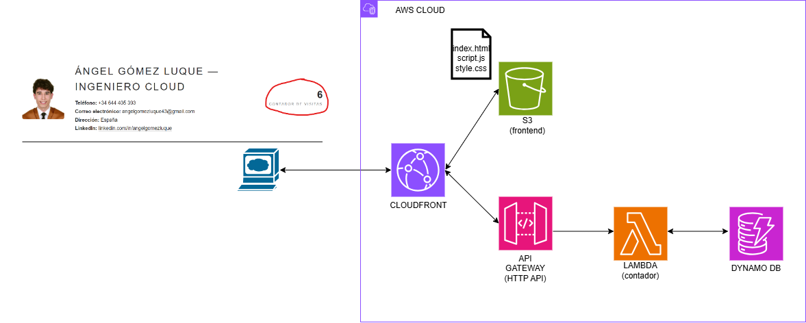

# Aplicacion Web Serverless AWS - Ángel Gómez Luque

**Aplicacion web serverless desplegada en AWS utilizando Terraform, Python y GitHub Actions.**

---

## Tabla de contenidos

- [Descripcion](#descripcion)

- [Arquitectura](#arquitectura)

- [Servicios AWS utilizados](#servicios-aws-utilizados)

- [Caracteristicas principales del proyecto](#caracteristicas-principales-del-proyecto)
  - [Infrastructure as Code](#infrastructure-as-code)
  - [CI/CD con GitHub Actions](#cicd-con-github-actions)
  - [Seguridad](#seguridad)
  - [Testing](#testing)

- [Retos del proyecto](#retos-del-proyecto)

- [Posibles mejoras futuras](#posibles-mejoras)

- [Lo que he aprendido](#lo-que-he-aprendido)

---

## Descripcion

Este proyecto consiste en una pagina web personal que contiene mi curriculum, desplegada en AWS con un backend serverless encargado de registrar y mostrar el numero de visitas.

La infraestructura se define mediante Terraform, mientras que el proceso de testing y despliegue se automatiza mediante GitHub Actions. Los workflows permiten gestionar automaticamente tanto los cambios en la infraestructura y el backend como las actualizaciones del contenido del frontend, manteniendo ambas partes del proyecto separadas y desplegandolas unicamente cuando es necesario.

---

## Arquitectura

1. El usuario accede a la pagina web a traves de CloudFront, que sirve los archivos estaticos desde S3.
2. El frontend ejecuta JavaScript y realiza una peticion a la ruta relativa `/visitas` del mismo dominio.
3. CloudFront identifica la ruta `/visitas` y reenvia la peticion a API Gateway, sin cache.
4. API Gateway invoca la funcion Lambda.
5. Lambda incrementa el contador en DynamoDB.
6. Lambda devuelve el numero de visitas como respuesta HTTP, que vuelve al navegador por el mismo camino (API Gateway, CloudFront).
7. El JavaScript del frontend recibe la respuesta y muestra el resultado en la pagina web.

---

### Servicios AWS utilizados

- **Amazon S3:** he utilizado S3 para almacenar y servir los archivos estaticos del frontend, evitando la necesidad de mantener un servidor web.

- **CloudFront:** he utilizado CloudFront como unico punto de entrada de la aplicacion, con dos origenes: S3 para el frontend y API Gateway para el backend. Mediante comportamientos por ruta, el contenido estatico se sirve con cache de 24 horas y la ruta `/visitas` se reenvia a la API sin cache, para que el contador siempre sea en vivo. Ademas, el acceso al bucket S3 se restringe mediante OAC, evitando exponerlo directamente, y se redirige HTTP a HTTPS para cifrar las comunicaciones con los usuarios.

- **API Gateway:** he utilizado API Gateway (HTTP API) para exponer el backend mediante un endpoint HTTP accesible desde el frontend.

- **AWS Lambda:** he utilizado Lambda para ejecutar la logica del backend de forma serverless, sin tener que gestionar servidores.

- **DynamoDB:** he utilizado DynamoDB para almacenar el contador de visitas mediante una base de datos NoSQL serverless y capacidad bajo demanda.

- **IAM:** he utilizado IAM para gestionar los roles y permisos necesarios para controlar el acceso a los recursos de AWS.

- **Parameter Store:** he utilizado Parameter Store para almacenar valores de configuracion generados durante el despliegue, como el nombre del bucket S3 y el ID de CloudFront. De esta forma, estos valores pueden recuperarse automaticamente en los workflows, evitando tener que introducirlos manualmente y permitiendo que el despliegue siga funcionando aunque la infraestructura se destruya y se vuelva a crear con nuevos valores.

---
## Características principales del proyecto

### Infrastructure as Code

La infraestructura de AWS se define y gestiona mediante **Terraform**, permitiendo versionar los recursos y reproducir el entorno de forma consistente.

La carpeta `terraform/` contiene los principales archivos utilizados para definir la infraestructura:

- **`terraform.tf`**: define la version de Terraform, los providers utilizados y el backend de Terraform.
- **`main.tf`**: define los recursos de AWS que forman la infraestructura.

#### Decisiones técnicas

- **S3 como backend de:** se utiliza un bucket S3 para centralizar el estado de Terraform, permitiendo gestionar la infrastructura tanto en local en cualquier máquina como GitHub Actions.

### CI/CD con GitHub Actions

El proyecto utiliza tres workflows independientes para automatizar el testing y despliegue del proyecto:

- **Infrastructure.yml:** ejecuta los tests de Python para validar la lógica de Lambda y, si son correctos, inicializa, valida y despliega la infraestructura de AWS mediante Terraform.

- **Frontend.yml:** sincroniza los archivos del frontend con el bucket de Amazon S3 mediante `aws s3 sync`, copiando los archivos nuevos o modificados y eliminando los que ya no existen en el proyecto. De esta forma, el contenido desplegado en S3 se mantiene actualizado con el código del repositorio.

- **Destroy.yml:** ejecuta Terraform para eliminar de forma controlada los recursos de AWS gestionados por el proyecto.

#### Ejecucion de los workflows

La primera ejecución se realiza manualmente mediante `workflow_dispatch` para crear inicialmente la infraestructura y realizar el primer despliegue. Primero `Infrastructure` y luego `Frontend`, en ese orden, ya que tienen que estar primero los recursos para poder subir el archivo al bucket.

A partir de ese momento, `Infrastructure` y `Frontend` se ejecutan automáticamente mediante `push` a la rama `main`, utilizando filtros `paths` para ejecutar únicamente el workflow correspondiente a los archivos modificados:

- Los cambios en `terraform/`, `lmbda/` o `test/` desencadenan **Infrastructure**, ejecutando los tests y el despliegue mediante Terraform.

- Los cambios en `frontend/` desencadenan **Frontend**, sincronizando los archivos modificados con S3.

- **Destroy** se ejecuta únicamente de forma manual mediante `workflow_dispatch`, evitando que una modificación del repositorio pueda eliminar accidentalmente la infraestructura.

### Seguridad

- **OIDC para GitHub Actions y minimo privilegio:** los tres workflows (`Infrastructure`, `Frontend` y `Destroy`) utilizan GitHub Actions OIDC para obtener credenciales temporales de AWS mediante IAM Roles, evitando almacenar credenciales de AWS de larga duracion en GitHub. Los workflows `Infrastructure` y `Destroy` comparten un mismo rol, ya que Terraform necesita los mismos permisos para crear y destruir los recursos, mientras que `Frontend` utiliza un rol propio con unicamente los permisos necesarios para su tarea: sincronizar el bucket S3, invalidar CloudFront y leer sus parametros de Parameter Store, sin capacidad de crear ni destruir infraestructura. Ademas, la trust policy de cada IAM Role limita que repositorio de GitHub puede asumirlo, evitando que otros repositorios puedan utilizarlo.

-**Bucket S3 privado mediante CloudFront OAC:** el bucket utilizado para almacenar el frontend no permite acceso público directo. Se configura Origin Access Control (OAC) para que únicamente la distribución de CloudFront pueda acceder a los objetos de S3 y servirlos a los usuarios.

-**HTTPS mediante CloudFront:** se configura CloudFront para redirigir las peticiones HTTP a HTTPS, utilizando el certificado TLS proporcionado por CloudFront para cifrar las comunicaciones con los usuarios.

### Testing

El backend utiliza **pytest** para realizar tests automatizados sobre la logica de AWS Lambda.

Los tests se ejecutan sobre `lambda_function.py` y comprueban que Lambda construye correctamente la llamada a DynamoDB para incrementar el contador de visitas en +1 y que ademas procesa correctamente la respuesta.

#### Decisiones técnicas

Para evitar realizar llamadas reales a AWS durante los tests, se utiliza `unittest.mock` para simular la tabla de DynamoDB. De esta forma, las pruebas se ejecutan de forma aislada y no generan cambios en la cuenta de AWS. Para ello se simula que la tabla devuelve un numero fijo y se comprueba que Lambda recibe correctamente ese valor y lo incluye en la respuesta de la API.

---

## Retos del proyecto

### 1. Cambio del contenido de la pagina web de curriculum

**Problema:**

Al modificar los archivos de la pagina web y sincronizarlos con S3, CloudFront puede seguir sirviendo la version anterior debido a la política de caché configurada, que en este caso mantiene los archivos almacenados en cache durante 24 horas.

**Solucion:**

Se añadio una invalidacion de cache de CloudFront al workflow de frontend.yml despues de sincronizar los archivos con S3. De esta forma, se elimina el contenido almacenado en cache y, en la siguiente petición, CloudFront obtiene la version actualizada desde S3.

La invalidacion se realiza mediante:

- name: Invalidate CloudFront cache
  if: github.event_name == 'push'
  run: |
    aws cloudfront create-invalidation \
      --distribution-id "$CF_ID" \
      --paths "/*"

El uso de if: github.event_name == 'push' evita realizar la invalidacion durante la primera ejecución manual mediante workflow_dispatch. Esto es importante porque esta se usa durante el primer despliegue, momento en el que la distribución de CloudFront acaba de crearse y todavia no existe contenido en cache. De esta forma, la invalidacion solo se realiza cuando el workflow se ejecuta automaticamente como consecuencia de un cambio en el frontend.

### 2. Configuracion dinamica del ID de Cloudfront

**Problema:**

El workflow encargado de desplegar el frontend necesita el ID de la distribucion de CloudFront para poder realizar la invalidacion de cache despues de actualizar los archivos de S3.

Sin embargo, este ID es generado por AWS y puede cambiar si la infraestructura se destruye y se vuelve a crear. Por tanto, no es conveniente introducirlo manualmente como una variable fija en el workflow.

Ademas, la infraestructura y el frontend se despliegan mediante workflows independientes, por lo que es necesario disponer de un mecanismo para compartir este valor entre ambos.

**Solucion:**

Terraform almacena automaticamente el ID de la distribución de CloudFront en AWS Systems Manager Parameter Store durante el despliegue de la infraestructura. Posteriormente, el workflow del frontend obtiene este valor desde Parameter Store y lo utiliza para realizar la invalidacion de cache de CloudFront.

De esta forma, el ID utilizado por el workflow siempre corresponde a la distribucion actualmente desplegada, incluso si la infraestructura se destruye y se vuelve a crear, manteniendo todo el proceso automatizado.

### 3. Exposicion de la API

**Problema:**
En la version inicial, el frontend realizaba las peticiones directamente contra el endpoint publico de API Gateway (`https://xxxx.execute-api.<region>.amazonaws.com`). Esto generaba varios inconvenientes:

- Al ser un dominio distinto al del frontend, era necesario configurar CORS en la API, indicando como origen permitido el dominio de CloudFront. Esto creaba ademas una dependencia entre ambos recursos (la API dependia de CloudFront para su configuracion de CORS).
- El frontend necesitaba conocer la URL de la API, que se genera durante el despliegue. Para ello habia que almacenarla en Parameter Store e inyectarla en el JavaScript durante el workflow de despliegue.
- Si la API se recreaba y su endpoint cambiaba, el valor tenia que propagarse de nuevo al frontend.

**Solucion:**
Se ha configurado CloudFront como unico punto de entrada tanto del frontend como de la API. La distribucion tiene dos origenes (S3 y API Gateway) y un comportamiento por ruta: las peticiones a `/visitas` se reenvian a API Gateway sin cache, y el resto se sirven desde S3 con cache.

De esta forma, el frontend realiza las peticiones con una ruta relativa, utilizando el mismo dominio desde el que se sirve la web:

`fetch("/visitas")`

en lugar de utilizar la URL generada por API Gateway.

## Posibles mejoras futuras

- **Separacion de roles IAM para Destroy:** utilizar un IAM Role independiente para el workflow `Destroy`, con permisos de borrado pero sin permisos de creacion, y restringir su asuncion a un *environment* de GitHub con aprobacion manual para evitar destrucciones accidentales.

- **Dominio personalizado:** registrar y configurar un dominio personalizado para la aplicacion mediante Route 53 y asociarlo a CloudFront utilizando un certificado TLS de AWS Certificate Manager (ACM), sustituyendo el dominio de Cloudfront por un dominio propio. Esta mejora no la he implementado debido al coste economico asociado al registro.

- **AWS WAF en CloudFront:** asociar un Web ACL de AWS WAF a la distribucion de CloudFront para proteger tanto el frontend como la ruta `/visitas` de la API, que al estar detras de CloudFront queda cubierta por la misma proteccion. Esta mejora no la he implementado debido a que no se justifica para este proyecto, un contador de visitas simple.

## Lo que he aprendido

En este proyecto he podido comprobar en la practica la utilidad de **Infrastructure as Code**. Aunque inicialmente puede parecer mas lento que crear los recursos directamente desde la consola de AWS, cuando la infraestructura empieza a crecer resulta mucho mas eficiente y reproducible. Poder crear o eliminar toda la infraestructura desde cero mediante unos pocos comandos facilita mucho la gestion y evita tener que realizar manualmente cada configuracion.

Para ello he aprendido a utilizar **Terraform** para definir y gestionar infraestructura como codigo. Esto me ha obligado a familiarizarme con su documentacion y, sobre todo, a entender conceptos como el **estado de Terraform**, los providers, los recursos y la relacion entre la configuracion y la infraestructura desplegada.

Por otro lado, he aprendido a utilizar **GitHub Actions** para automatizar diferentes partes del proyecto. La posibilidad de definir workflows que ejecuten tests, desplieguen infraestructura o actualicen el frontend automaticamente me ha permitido entender mejor como se aplican los conceptos de **CI/CD** en un proyecto real.

Ademas, el proyecto me ha servido para llevar a la practica conceptos que previamente habia estudiado de forma teorica sobre diferentes servicios de **AWS**. Al tener que conectar servicios como S3, CloudFront, API Gateway, Lambda, DynamoDB, IAM y Parameter Store, he podido entender mucho mejor como funcionan individualmente y, sobre todo, como se relacionan entre ellos para construir una aplicacion completa.

En general, el proyecto me ha permitido pasar de conocer estos conceptos principalmente desde un punto de vista teorico a entender como se aplican en un entorno practico, teniendo que tomar decisiones, resolver problemas y automatizar todo el proceso de despliegue.
